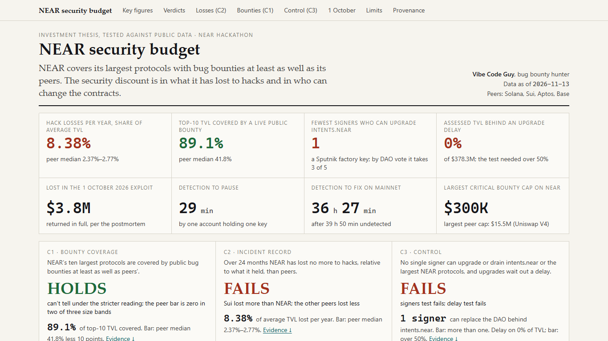
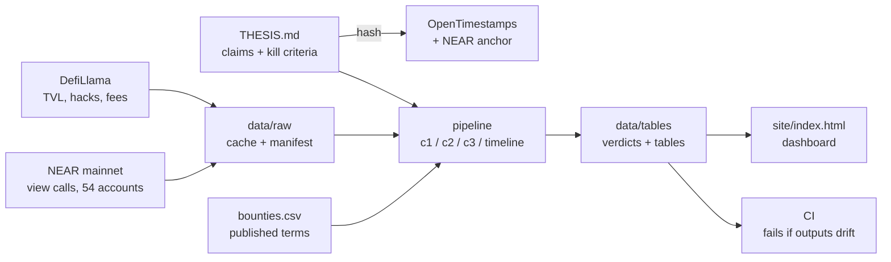

<h1 align="center">NEAR Security Budget</h1>

<p align="center">
  <b>Is NEAR safe enough to settle agent money?</b><br />
  Three tests, fixed before the data was pulled, run against Solana, Sui, Aptos and Base. Anyone can re-run them with one command and no keys.
</p>

<p align="center">
  <a href="https://github.com/vibe-code-guy/near-security-budget/actions/workflows/rebuild.yml"></a>
  
  
  
  <a href="https://nearblocks.io/txns/DsdB2BqHAHxyY2Ud4GYcek7JirLYMJz2tLY1iDNAVXji"></a>
  
</p>

<p align="center">
  
</p>

Built for the NEAR HACKATHON. Track: `thesis` (Investment Thesis). By Vibe Code Guy, bug bounty hunter.

**Dashboard:** open [`site/index.html`](site/index.html) from a clone (no server needed), or https://vibe-code-guy.github.io/near-security-budget/ once Pages is enabled · **The thesis:** [`THESIS.md`](THESIS.md) · **Screenshots of every section:** [`docs/screens/`](docs/screens/) · **Anchor on NEAR:** [`DsdB2BqH…`](https://nearblocks.io/txns/DsdB2BqHAHxyY2Ud4GYcek7JirLYMJz2tLY1iDNAVXji)

## In one minute

- **Problem.** Agents that hold and move money need a settlement layer whose
  contracts cannot be quietly changed or drained. "Is this chain secure?" is
  usually answered with opinion.
- **Idea.** Treat security as a budget you can measure: what an ecosystem pays
  to find bugs, what it has lost, and how many keys stand between an attacker
  and the contracts, all relative to the value secured. Write the tests and
  their pass/fail rules first, hash them, then pull the data.
- **Result.** Three claims, each "NEAR meets the peer bar". The verdicts are
  the registered rules applied by code; nothing is scored by hand.

| Claim | Verdict | The number that decided it | The bar |
|---|---|---|---|
| **C1 Bounty coverage** | **HOLDS**, with a caveat: can't tell under the stricter reading; the peer bar is zero in two of three size bands | 89.1% of NEAR's top-10 TVL has a live public bounty | peer median 41.8%, less 10 points |
| **C2 Incident record** | **FAILS** | NEAR lost 8.38% of its average TVL per year over 24 months | peer median 2.37% to 2.77% |
| **C3 Control** | **FAILS** | 1 key on the Sputnik DAO factory can replace the DAO that owns `intents.near`; 0% of assessed TVL sits behind an upgrade delay | more than one signer; delay on over 50% |

**What the data shows.** On bounty coverage NEAR is at or above these peers.
The gap is in the loss record and in control. The security discount comes from
those two, not from bounty spending. The author, a bug bounty hunter, expected
C1 to fail. It did not.

**What would close the gap:** an enforced upgrade delay; removing the factory
path (deploy the merged fix, or turn `auto_update` off on the three DAOs that
have it on); and, as a lesser point, a larger critical bounty cap.

## Judge walkthrough: do X, see Y

**In a browser, no install (about 3 minutes):**

| # | Do | See |
|---|---|---|
| 1 | Open [`docs/screens/01-top.png`](docs/screens/01-top.png), or clone and open `site/index.html` | Rings for NEAR and each peer chain, eight key figures (8.38%, 89.1%, 1, 0%, $3.8M, 29 min, 36 h 27 min, $300K) and three verdict panels: C1 HOLDS with its caveat, C2 FAILS, C3 FAILS |
| 2 | On the dashboard, go to **Losses (C2)** and hover the bars | NEAR 8.38% per year, Solana 2.62–2.87%, Sui 9.97%, Aptos 2.13%, Base 0.30–2.66%, with the peer median line at 2.37–2.77%. Below: the 98 hack rows; click **Amount** to sort |
| 3 | Go to **Control (C3)** | A matrix of seven protocols by pause, upgrade, move funds and delay. Three show a red **1** under upgrade; every row shows **none** under delay. Below it, the control path for `intents.near` with one red arrow: "1 key: replace the DAO's code, no vote" |
| 4 | Go to **1 October** | The NEAR Intents exploit to scale: undetected 39 h 50 min, paused 29 min after detection, fixed 35 h 58 min after the pause. Every event links to its source |
| 5 | Open the anchor transaction on [nearblocks](https://nearblocks.io/txns/DsdB2BqHAHxyY2Ud4GYcek7JirLYMJz2tLY1iDNAVXji) | A `set` call on `social.near` by `near-thesis.near` storing the SHA-256 of the registered thesis and its commit id |

**With a clone (Python 3.9+, nothing to install, no API keys, no wallet):**

| # | Do | See |
|---|---|---|
| 6 | `make all` (or `python -m pipeline build && python -m unittest discover -s tests -q`) | `C2: fails \| NEAR lower/upper %/yr: 8.378968 8.378968 \| peer median: 2.374327 2.765235`, `C3a: fails \| C3b: fails \| C3: fails`, `C1a: holds \| C1b: holds \| C1: holds \| coverage NEAR 89.06% vs peer median 41.79% \| score 98.92%`, `C1 sensitivity (not registered): can't tell`, `site/data.js written`, then `Ran 36 tests` and `OK` |
| 7 | `git status` after step 6 | No changed files. The committed tables and dashboard data are exactly what the code produces; CI fails if they ever differ |
| 8 | Check C3 on chain yourself: [the two view calls below](#check-the-one-key-path-yourself) | Three `FullAccess` keys on `sputnik-dao.near`, and `{"factory_id":"sputnik-dao.near","auto_update":true}` from the DAO that owns `intents.near` |
| 9 | Check C2 by hand: open `data/tables/c2_hacks_attributed.csv`, filter `chain = Near` and `in_24m_window = yes` | Three rows: Rhea Lend $18.4M, Sweat Foundation $3.5M, NEAR Intents $3.8M. Their sum, annualised over NEAR's mean TVL in `data/tables/c2_loss_rates.csv`, is 8.38% |
| 10 | `git show f84b548:THESIS.md \| sha256sum` | `2b99cec36f2b2d575367d2e053d006a3495df0fcbffc0294b52dd77ff921b58b`, the hash anchored on NEAR and timestamped on Bitcoin |
| 11 | Optional, needs network: `make data` | Every file in `data/raw/` re-fetched; `data/raw/manifest.json` updated with retrieval times and NEAR block heights. The frozen universe is not changed. Numbers move with the market; the committed cache is what the results use |

### Check the one-key path yourself

Read-only, no account needed:

```
curl -s https://free.rpc.fastnear.com -H 'Content-Type: application/json' -d '{"jsonrpc":"2.0","id":"1","method":"query","params":{"request_type":"view_access_key_list","finality":"final","account_id":"sputnik-dao.near"}}'
```

```
curl -s https://free.rpc.fastnear.com -H 'Content-Type: application/json' -d '{"jsonrpc":"2.0","id":"1","method":"query","params":{"request_type":"call_function","finality":"final","account_id":"intents.sputnik-dao.near","method_name":"get_factory_info","args_base64":"e30="}}'
```

The first lists the factory's keys (three with `"permission":"FullAccess"`
when this was written). The second returns a byte array that decodes to
`{"factory_id":"sputnik-dao.near","auto_update":true}`. The DAO code these
DAOs run accepts a code replacement from the factory, with no vote, when
`auto_update` is true. The dashboard's C3 section walks through it.

## Guide for judges

| If you want to check | Look at |
|---|---|
| What was claimed, and the pass/fail rules | [`THESIS.md`](THESIS.md) sections 1 to 5 |
| What the author knew beforehand, and his conflict of interest | `THESIS.md` sections 2 and 3 |
| The evidence, for and against | `THESIS.md` section 9; the dashboard |
| Everything decided after the claims were registered | `THESIS.md` section 10 (14 entries) |
| That the claims came before the data | [Pre-registration](#pre-registration) below |
| Any single number | `data/tables/` (CSV and JSON), rebuilt by `make all` |
| Where a number came from | `data/raw/manifest.json`: source URL or view call, retrieval time, SHA-256, block height |
| How a verdict is computed | `pipeline/c1.py`, `pipeline/c2.py`, `pipeline/c3.py`; rules unit-tested in `tests/` |
| Who can upgrade what on NEAR | `data/c3_findings.json` (hand-read trace) and `data/raw/near/` (cached chain state) |
| The demo post and video script | [`docs/submission-kit.md`](docs/submission-kit.md) |

### Track

| Track | How this project fits |
|---|---|
| `thesis` Investment Thesis | A long-term thesis for NEAR backed by on-chain data, a live dashboard and a model anyone can re-run. Judged on the evidence: two of the three claims fail, and the write-up says so |

## How it works



1. **Register.** The thesis, three claims and their kill criteria are written
   in `THESIS.md`, committed, hashed, timestamped and anchored on NEAR.
2. **Pull.** `make data` fetches DefiLlama data and runs read-only view calls
   on NEAR mainnet, caching every response with its retrieval time and block
   height.
3. **Compute.** `make all` rebuilds every table and verdict from the cache,
   with no network, and runs the tests.
4. **Show.** The dashboard reads one generated file, `site/data.js`. Every
   chart states its finding, its unit and date, and the query behind it.

## The three claims

| | C1 Bounty coverage | C2 Incident record | C3 Control |
|---|---|---|---|
| **Question** | Are NEAR's ten largest protocols covered by public bug bounties as well as peers', size for size? | Has NEAR lost no more to hacks over 24 months, relative to what it held? | Can one signer upgrade or drain `intents.near` or the largest NEAR protocols, and is there an upgrade delay? |
| **Data** | 51 listings; published bounty terms; DefiLlama TVL | DefiLlama hacks and chain TVL history, 730 days | View calls on 54 NEAR accounts; open-source contract code |
| **Verdict** | Holds, with a caveat | Fails | Fails on both tests |
| **Read first** | The bar is zero in two of three size bands, and 24 of 51 lookups were not finished | Sui is worse than NEAR; NEAR's figure rests on three hacks | The factory path was already public; this trace extends it to NEAR Intents |

A case study traces the 1 October 2026 NEAR Intents exploit from chain data and
the official postmortem: reports said "fixed within an hour"; the chain shows
it was paused within the hour and fixed a day and a half later.

## How NEAR is used

- **Read-only view calls on NEAR mainnet** (`https://free.rpc.fastnear.com`,
  listed in the NEAR docs) for 54 accounts: `view_account`,
  `view_access_key_list`, and the contract views `acl_get_permissioned_accounts`,
  `pa_all_paused`, `up_get_delay_status` (near-plugins), `get_policy`,
  `get_factory_info` (Sputnik DAO), `get_owner`, `get_contracts_metadata`
  (Sputnik factory), and each protocol's owner views. Answers are cached in
  `data/raw/near/` with the block height each was read at.
- **Open-source contract code**, read at named commits to confirm what each role
  can do: `near/intents`, `near/near-plugins`, `near-daos/sputnik-dao-contract`,
  `aurora-is-near/aurora-controller-factory`, `Near-One/omni-bridge`, and the
  protocols' own repositories.
- **NEAR transactions** for the case-study timeline: the pause, release
  registration, upgrade and unpause calls on `intents.near` and its upgrade
  controller, each with a source.
- **The claims are anchored on NEAR**: the hash of `THESIS.md` is stored under
  `near-thesis.near` in SocialDB (`social.near`).
- **Protocols covered**: NEAR Intents, Rhea (Lend, LST, Dex), Meta Pool, the
  NEAR bridge and LiNEAR, all controlled through Sputnik DAOs.

## Pre-registration

| Event | When (UTC) | How to check |
|---|---|---|
| Claims committed: `f84b54871db3b51f5db5ff113b34ef0f76745f56` | 2026-11-13 06:45:58 | `git show f84b548:THESIS.md \| sha256sum` gives `2b99cec36f2b2d575367d2e053d006a3495df0fcbffc0294b52dd77ff921b58b` |
| OpenTimestamps stamp of that text | 2026-11-13 07:27 | `registration/THESIS.f84b548.md.ots`; Bitcoin blocks 975645, 975648, 975658 |
| First data pull | 2026-11-13 07:28:54 | `data/raw/manifest.json` |
| Anchor on NEAR | 2026-11-13 11:41:07 | account `near-thesis.near`, transaction [`DsdB2BqHAHxyY2Ud4GYcek7JirLYMJz2tLY1iDNAVXji`](https://nearblocks.io/txns/DsdB2BqHAHxyY2Ud4GYcek7JirLYMJz2tLY1iDNAVXji), block 224358450 |

**The NEAR anchor came after the first data pull**, by about four hours. It
proves the text existed at 11:41 UTC, not that it preceded the data. The
evidence that it preceded the data is the OpenTimestamps proof (stamped about
two minutes before the first pull) and the git history. Commit dates are set by
the author's machine, so they are evidence of order, not proof.

Read the anchor back (view call, no account needed):

```
near contract call-function as-read-only social.near get json-args '{"keys":["near-thesis.near/near-security-budget/**"]}' network-config mainnet now
```

Check the timestamp: `pip install opentimestamps-client`, then
`ots verify registration/THESIS.f84b548.md.ots` (needs a Bitcoin node), or drop
the `.md` and `.ots` files on https://opentimestamps.org.

## FAQ

**Is this an attack or a vulnerability report?** No. It is read-only: no keys,
no transactions, no testing of any vulnerability, nothing sent to any contract.
The factory mechanism in C3 was already public (the hackathon project
[Docket](https://github.com/aditi3175/docket) described it, and the fix is
public pull request near-daos/sputnik-dao-contract #233). No separate notice
was sent before publication; `THESIS.md` section 10 records that.

**Why does C1 say "holds" if there is a caveat?** Because that is what the
registered rule gives. The caveat travels with it everywhere: in two of three
size bands the median peer has no live bounty, so the bar is zero; and when
unfinished lookups are not counted as zero, the rule says "can't tell".

**Who filled the bounty table?** An AI assistant with web access, on
2026-11-14. The author opened the four NEAR programme pages himself and the
maximums match. 24 of 51 rows were entered as "not checked". How those rows
count was decided after seeing the data and is logged in section 10.

**Does C2 depend on which TVL you divide by?** No. On a wider TVL base that
includes liquid staking, NEAR's rate is 3.91% against a peer median of 1.40% to
1.72%: still above. That check was added after registration and is labelled so.

**Is "one key" really one person?** Chain state cannot tell. A key may be a
hardware wallet or a shared key. The count is of keys that are each sufficient.

**Can I trust the numbers without running anything?** Run `make all`. It needs
only Python, takes seconds, and CI fails if the committed outputs differ.

**Is the dashboard hosted?** It works from disk. The workflow
`.github/workflows/pages.yml` serves `site/` on GitHub Pages once the owner
turns Pages on (source "GitHub Actions", then run the workflow or set the
repository variable `PAGES_ENABLED = true`).

## Repository layout

| Path | What |
|---|---|
| `THESIS.md` | Claims, kill criteria, what was known beforehand, evidence, limits, changes after registration |
| `site/index.html`, `site/data.js` | Static dashboard; `data.js` is generated |
| `site/vendor/echarts/` | Apache ECharts 5.5.1 (Apache-2.0), vendored with its licence |
| `docs/first-screen.png`, `docs/screens/` | Screenshots: first screen, and one per section |
| `docs/submission-kit.md` | Demo post drafts and demo script |
| `pipeline/` | `fetch.py` (`make data`), `universe.py`, `c1.py`, `c2.py`, `c3.py`, `timeline.py`, `site.py`, `build.py` |
| `tests/` | 36 unit tests of the attribution, band, threshold and verdict rules |
| `data/universe.csv` | The 51 listings, frozen at the first data pull |
| `data/bounties.csv`, `data/bounty_status_rules.json` | Bounty terms per listing, and how not-live and unfinished rows count |
| `data/c3_targets.json`, `data/c3_findings.json` | Accounts read for C3, and the hand-read control trace |
| `data/timeline_events.json` | Case-study rows and their sources |
| `data/raw/` | Cached raw responses and `manifest.json` |
| `data/tables/` | Every output table and verdict file |
| `registration/` | The registered text and its OpenTimestamps proof |
| `.github/workflows/` | `rebuild.yml` (CI: rebuild, test, fail on drift) and `pages.yml` (hosting, idle until enabled) |

## Status

- Done: all three claims computed, with sensitivity checks; case-study
  timeline; dashboard; CI.
- Not done: the per-control-set L2BEAT comparison column (given in words
  instead); Rhea Dex's control could not be read because its source repository
  was not found; 24 of 51 bounty lookups were not finished.
- Hackathon baseline: every commit was made during the hackathon window.

## Built with

- Python standard library only (`urllib`, `json`, `csv`, `gzip`, `unittest`).
- Plain HTML, CSS and JavaScript: no framework, no CDN, no build step.
- **Apache ECharts 5.5.1** for charts, Apache License 2.0, vendored unmodified
  in `site/vendor/echarts/` with its `LICENSE` and `NOTICE` (from the
  `echarts@5.5.1` npm package). The page loads nothing from the network.
- `opentimestamps-client` (Python), used once to stamp the registered text.
- Data: DefiLlama (free, keyless), NEAR mainnet RPC by FastNEAR, nearblocks
  explorer API for the timeline's transactions.

## AI disclosure

Claude Code (Anthropic's coding agent) wrote the code and drafted the documents
in this repository under the author's direction. The author chose the thesis
and approved the claims and kill criteria. The bounty table was filled by an AI
assistant with web access; the author checked the four NEAR programme pages.
Commits carry no co-author line, so this section is the disclosure.

## License

MIT, see [`LICENSE`](LICENSE).

## Related project disclosure

The same author also submitted
[Slay the Bear](https://github.com/vibe-code-guy/slay-the-bear) to NEAR
HACKATHON (tracks `memecoins`, `games`): a memecoin and town game in one NEAR
testnet contract. The two projects are independent and share no code.
